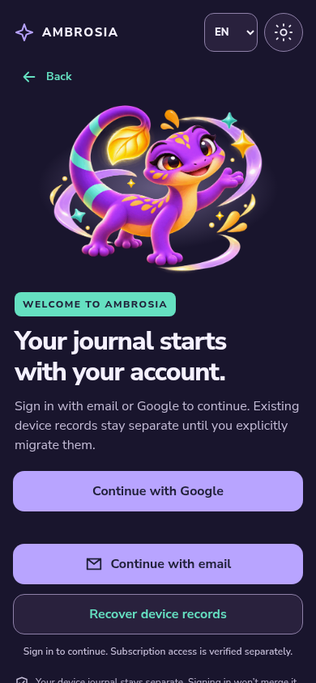
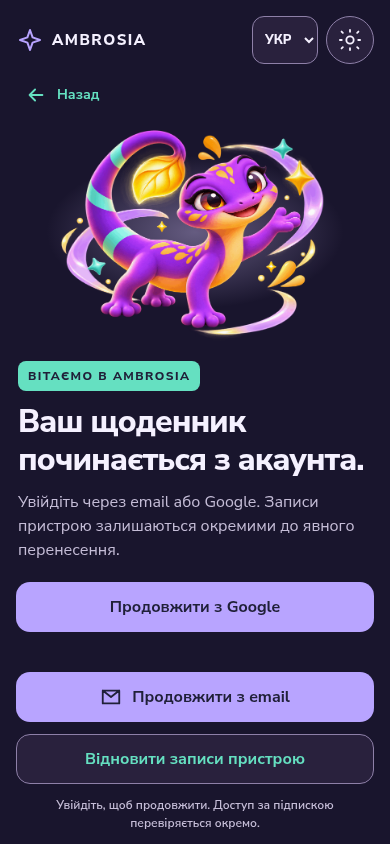
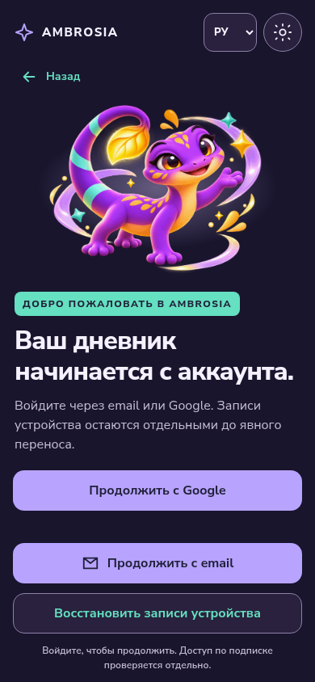
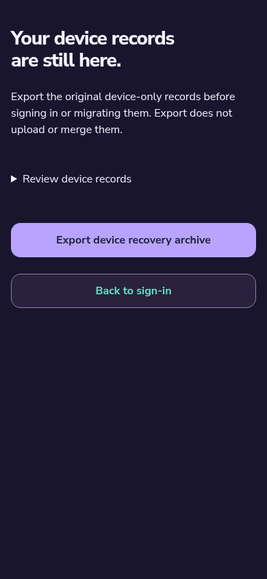
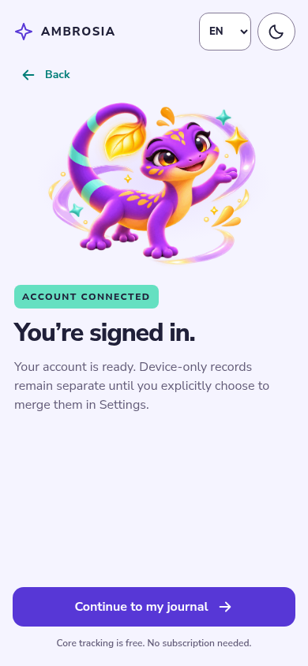

# PR A verification

Local verification, 15 November 2026. Synthetic health/account/provider data only.

| Check | Result |
| --- | --- |
| Focused OAuth/config/App Link tests | 35 passed: S256, nonce, exact callbacks, expiry, replay, cancellation, cold-start persistence, uncertain exchange, changed account generation, unverified/mismatched identity, denied/quota storage, defaults, actual-provider gate, association inputs, reversible/idempotent manifest filter |
| `npm test` | 164 passed, zero failures (includes existing security, billing lifecycle/ownership, sync, asset and model suites) |
| `npm run test:auth` | Passed: external-service/SDK/Capacitor fixtures with real application modules; fresh web callback, replay rejection, no implicit guest migration, verified-identity requirement, EN/UK/RU and light/dark, 320px controls without horizontal overflow, original-byte export, remembered restriction during outage, rollback, email signup/reset contract, native browser cancellation/late callback, persisted launch callback, delayed A response after switching to B and back |
| `npm run test:onboarding` | Passed: original three slides and account choice, 320/375/390/430px, EN/UK/RU, both themes, email/guest regressions, returning/offline launch, initialization/language races, missing image and large text/reduced motion |
| `npm run test:browser` | Passed: existing sync/conflict/offline/sign-out, account isolation, server Premium/AI checks, billing/restore/account-switch, wellness, Companion, export/deletion and responsive product scenarios |
| `npm run test:db` | Passed on disposable PostgreSQL 17: all migrations/RLS/RPC/anonymous/direct-write assertions; 24 concurrent quota and 36 chat/report requests; billing ordering, grace/expiry/refund and immutable ownership, export/deletion |
| `npm run build` | Passed; allowlisted static web output, source/references/tests excluded |
| Android prepare + `assembleDebug` | Passed with synthetic `org.example.ambrosia.billingfixture`, `https://example.invalid` API and exact `/auth/native-callback.html` filter; official plugins compiled. No signing secret, AAB, public release or Play upload. Local JDK/SDK/cache used because system JDK had no compiler. This is compile evidence, not native OAuth acceptance. |
| PNG preservation | All 23 original release PNG hashes/dimensions/alpha metadata pass existing tests; no artwork edited, converted, resized, recompressed or removed |

## Payload

Unpacked `web-dist`, with all feature flags absent/default false and no owner association file:

| Category | Bytes |
| --- | ---: |
| Whole static app | 5,829,916 |
| Ten runtime PNGs (unchanged) | 5,311,614 |
| JavaScript, 56 modules | 329,943 |
| CSS | 78,260 |
| Local fonts | 97,124 |
| Estimated separate-file gzip JS + CSS | 124,212 |

Gzip is a local reproducible estimate, not a measured CDN transfer. No framework bundle is added. Callback pages load only their required modules; account-choice art is the existing PNG with loading priorities unchanged. Future destination art is still lazy. The verifier/nonce and public configuration add a small temporary localStorage document; no guest records enter an OAuth request. Owner certificate association, if later configured, adds its generated JSON. Debug APK size is not a production release-size claim.

## Screenshots

Actual application UI with **synthetic, test-only validated configuration**. These screenshots do not attest a live provider or verified domain. Original Ari PNG artwork is unchanged.

| Surface | Screenshot |
| --- | --- |
| Staged account choice — EN light |  |
| Staged account choice — UK light |  |
| Staged account choice — RU dark |  |
| Original-device recovery |  |
| Verified callback result |  |

Existing three-slide screenshots remain in `docs/ambrosia-3/phase1/screenshots/`. Tests write current screenshots to `/tmp/ambrosia-auth-screenshots`; use `UPDATE_AUTH_SCREENSHOTS=1` only to refresh the checked-in synthetic examples intentionally.

## Limits and next review

Real Google consent/login, delivered email confirmation/recovery for Google-created accounts, actual signing certificates/domain verification, native process-kill/multi-window lifecycle and real Play purchase/renewal/grace/hold/refund scenarios require owner acceptance. Browser and database fixtures cannot certify those. Same-origin multiple windows may conservatively invalidate an in-flight attempt when another window changes auth; retry sign-in rather than trying to reuse a claimed code. Interrupted exchange is deliberately one-shot. Denied storage can prevent persisting cancellation across process death; restore storage and restart authentication before acceptance. No invalidation error may leave the previous account visible in the current document.

There is no Google-only deletion reauthentication shortcut: set a password using the existing verified-email recovery path first, then confirm deletion normally; this must be checked with real delivered mail. No new-account password or Google provider secret is fabricated.

Google is hidden by default. Mandatory navigation remains disabled. No new subscription restriction is enforced in A; UI flags cannot secure direct/old-client/offline writes. Complete and review B before enabling server access policy, then C before enabling the new journey; retain read/export/delete/manage/restore/auth/recovery rights. The [owner checklist, threat model and rollback](PR_A.md) are release gates. Stop after PR A for owner review.
