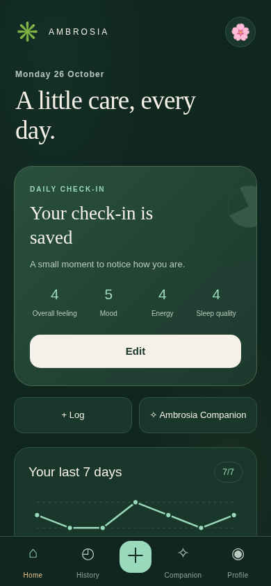
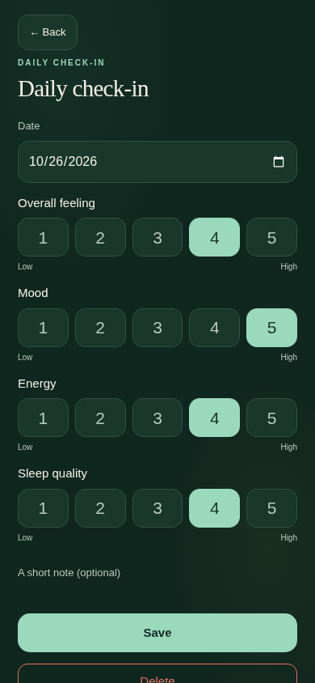
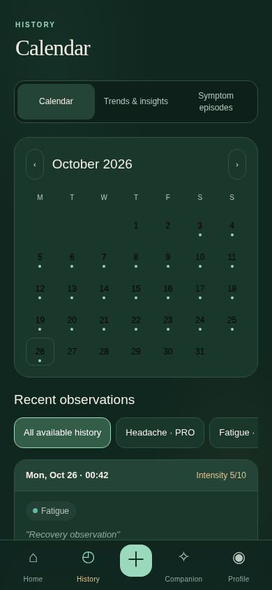
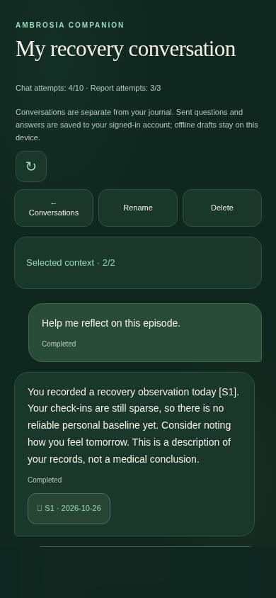
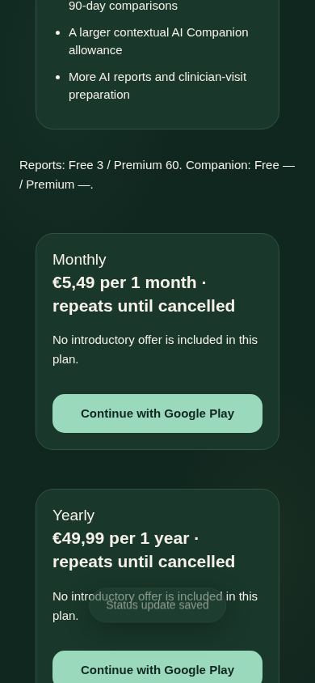

# Competitive and implementation audit

Audit date: 15 November 2026. Repository baseline: `main` at `fea4764203e6e3d9a827e0d259077113992a389e`. Read the existing [2.0 audit](../product-audit-2.md), [architecture](../ambrosia-2-release.md), [synchronization](../synchronization.md) and [current billing guide](../premium-billing.md) before assessing changes. The 2.0 documents' “billing is future” passages describe their historical release; actual main includes PR #21. Source and executable behavior take precedence over stale prose/comments (for example the old “export premium only” comment does not gate export).

Evidence labels: **R** repository/source inspection; **V** visually inspected screenshot; **P** publisher claim; **U** a visible public review, not a verified product defect; **H** hypothesis/recommendation. No installed competitor session, signup, purchase or longitudinal usability study was performed.

## Current product: retain, polish, distinguish missing work

| Area and code evidence | What exists (R) | Incomplete/uncertain | 3.0 change, without rebuilding the engine |
| --- | --- | --- | --- |
| Home: `js/screens/home.js`, existing Home screenshot | Four check-in values, edit action, symptom/Companion shortcuts, weekly trend and sufficiency | Visual hierarchy, greeting/card height, ambiguous “+ Log”, glyph identity | Compact today hero, named actions and expressive identity; keep `statistics()` and record counts |
| Check-in: `js/screens/checkin.js`, `js/wellness/model.js` | One deterministic account/day identity; four required 1–5 values **when saving a check-in**; optional note/date edit/CAS/delete | Numeric-only expression; changing date re-renders the form and can discard uncommitted choices | Labeled expressive controls and reviewed draft/date-change guard; check-in itself remains optional, no schema/scale change |
| Symptoms: `js/screens/log.js`, `js/modal.js` | Quick/Advanced entry, taxonomy, triggers, intensity 1–10, notes, onset/end, optional episode and status follow-up | Dense legacy advanced markup; high intensity automatically enables critical follow-up; real-device burden unmeasured | Improve wording/grouping; retain follow-up and stored semantics; do not turn high intensity into a diagnosis or a guilt alarm |
| Episodes: `js/screens/episode.js` | Named episodes, explicit status/start/end, links to observations and Companion | Discovery/visual storytelling | Expose recovery grouping in History; preserve explicit completion, not AI inference |
| History: `js/screens/history.js`, `js/wellness/charts.js` | Calendar/day/list/insights/episodes; gaps for missing check-ins; free weekly/baseline; Premium filtering and 90-day comparison | Small calendar targets; graph labels mostly summary-level; no verified causal factor engine | Better calendar touch layout, chart/table alternatives and useful count/context labels |
| Companion: `js/companion/`, `netlify/functions/chat.js` | Saved multi-turn chat, selected context preview, sources/revisions, explicit consent, offline drafts, separate quota, exports, failed-turn recovery | Context controls dense; provider answers not clinically validated | Context capsule → review sheet, source chips, readable turn states; reuse engine and protected routes |
| Account: `js/supabase-auth.js`, `js/account-management.js` | Email/password signup/sign-in, confirmation/reset/recovery, offline local data, account export/delete | **No `signInWithOAuth`, Google provider button or implemented native OAuth callback** | Improve existing email surface now in future UI work; Google is optional new engineering with its own gate |
| Premium: `js/billing/`, `lib/billing.js`, migration 006 | Official native RevenueCat bridge, store plans/phases, restore/manage, server-only confirmation, webhook dedup/reconciliation, grace V2 guard | Owner product/key/dashboard configuration and real internal-track purchase results are not demonstrated by source | Restyle value hierarchy and pending/error states; do not redo verification or claim live monetization acceptance |
| Onboarding: `js/screens/onboarding.js` | **One** localized welcome screen with abstract glyphs and guest start | Three illustrated slides are genuinely missing (earlier docs' wording is not the implementation) | Add a three-slide presentation later; guest migration logic stays explicit |
| Navigation: `index.html`, `js/navigation.js` | Four button destinations plus central unlabeled visual plus; navigation hidden on editing screens | Mixed Unicode glyphs; Profile vs Settings ambiguity; floating add competes with Home | Consistent outlined icons, always-visible labels and four-slot geometry; prototype shortcut removal |
| Android: `scripts/`, `native/sdk.js`, `js/platform.js`, manual build workflow | Bundled Capacitor 8 UI; native Billing, App/Browser, Filesystem/Share; lifecycle handling; manual test APK/AAB | Native Back currently routes most screens Home; unsaved-form/overlay behavior needs device review; OAuth absent | Specify predictable Back/draft behavior as an explicit implementation item, not a claim that it already works |
| Access/localization: `copy.js`, `i18n.js`, `css/product.css` | EN/UK/RU product/billing copy; focus, zoom, reduced-motion rules; browser viewport suite | Mixed copy catalogs, some generic labels, chart/calendar accessibility not independently audited | Token glossary and semantic component contracts; manual screen-reader/large-text checks |

Existing tests and screenshots are prior fixture evidence, not a statement that live Supabase, Groq, Play Billing, OAuth or a clinical study passed. No functional suite was rerun for this documentation-only PR.

## Verifiable competitive sources

Retrieved English/US listing versions on the audit date. App identity matters: **Symptom Tracker** below is the exact package requested, by **CareClinic Tracker & Reminder / Careclinic Software Inc.**, not another app with the same title.

| ID | Source | Evidence actually retrieved |
| --- | --- | --- |
| B1 | [Bearable official site](https://bearable.app/) | P: customizable tracking, factors, reports/correlations, health experiments, reminders/goals, device integrations, export/privacy descriptions; on-page FAQ available |
| B2 | [Bearable Play listing — `com.bearable`](https://play.google.com/store/apps/details?id=com.bearable&hl=en&gl=US) | P/V/U: title “Symptom, Mood & Period Tracker”, description, promotional screenshots, visible review sample; not an installed app |
| S1 | [Symptom Tracker Play listing — exact requested package](https://play.google.com/store/apps/details?id=symptom.tracker.track.symptoms.journal.diary.checker&hl=en&gl=US) | P/V/U: description, developer identity, screenshot gallery, visible reviews and release notes |
| S2 | [Publisher symptom-tracker page](https://careclinic.io/symptom-tracker/) | Listed as the developer URL in S1; **not independently fetched for this audit**, so feature claims here rely on S1 |
| A1 | [Ambrosia screenshots](../screenshots/) and source files above | R/V: repository-owned fixture screenshots and source inspection |

B1 FAQ is on the homepage. Attempts to retrieve separate `/faqs/` and `/reviews/` returned 404; no evidence is attributed to them. Earlier 2.0 alternative-app research is historical context, not freshly verified competitor behavior.

### What was visually observed

Bearable gallery images 1–3 (B2): saturated cyan/lime/teal promotional fields; a white bear with blue clothing; dark-blue bold typography; colored category symbols; a date strip and substantial white category cards; a factors-to-symptoms comparison screen with colored percentage bars. This creates recognition and a clear association between an emotion-friendly character and dense tracking. The strong marketing fields do **not** establish that the installed app uses those same backgrounds everywhere. Its “find what triggers/helps” and testimonial/statistical headlines are publisher marketing, not independently established causality or efficacy.

Symptom Tracker gallery images 1–3 (S1): orange/pink marketing framing, white/light cards, colored category tiles, a multi-section check-in, 1–10 severity with a body-map row, symptom presence controls, blue outlines and a green save action. No recurring mascot was visible in these three images; that is not proof the entire app has none. The gallery mixes typographic treatments and information density. Its “100K users / 87% 5-stars” artwork is not equivalent to current install/review metadata; Ambrosia must not copy unverifiable social proof.

Ambrosia Home (A1): deep green surface-on-green, large editorial serif greeting and status card, small generic symbols, narrow mint action/navigation. This feels cohesive but comparatively quiet; much of the first viewport is greeting/status rather than a clearly named next action. That visual judgment is an audit assessment, not a measured conversion result.

Exact public gallery assets inspected (reference links only; competitor artwork is not copied into this repository):

- Bearable: [gallery 1](https://play-lh.googleusercontent.com/0AyjzF1rfmTl95kLvUKE34t3cxnRaAOt0UCWDpjQ080hcNHja1RBZ4DmumsKCggmZ7-zheAiw9gKfVLU8wlaFQ=w1080), [gallery 2](https://play-lh.googleusercontent.com/14TCKMi3g1AuTJxuCiZ0owA2h9FkPSaz5cSO-APImzOI6C2bOKJlCrW4fHcaKtrS0WN1aeGDhXITD8c1U32Yuw=w1080), [gallery 3](https://play-lh.googleusercontent.com/4OK-MpR_aHDXPo9NNh1kpx0PYdn-BVbaKkTyf9HUYW9QABaY30_vdbEPQ_PteNeMmWBzWfGN3YhdV5QijgZf=w1080).
- Symptom Tracker: [gallery 1](https://play-lh.googleusercontent.com/gyK582D_6SuD4eJjeKvuEQwaAPmtIowkUxYxaSCjOeaQ-b34AP094ygIIGAEcq8wKRSeOw6SfKd_7oQsbRnk=w1080), [gallery 2](https://play-lh.googleusercontent.com/1Li9U7A0-6-1Hq1y5Bu86RG-rPYj29vPsVG_XlqxZc1UxtlbilcuOGMS9CSfmB_ouo469ucDI5Mr6vyGm6C-Wg=w1080), [gallery 3](https://play-lh.googleusercontent.com/YjNk1uxRdwFQz9MNrRvBOjfI-EALvhg9olzh_DixEV4gHXsFxJAizrSSMg1BA6ih8whY5T5Dmf1GzQ6Xmpk78g=w1080).

## Feature and experience matrix

“Opportunity” means supported by code or publisher evidence, not a claim to outperform an installed competitor in testing.

| Dimension | Ambrosia today (R/V) | Bearable primary reference (P/V) | Symptom Tracker exact package (P/V) | Decision / relative advantage to validate |
| --- | --- | --- | --- | --- |
| Brand/mascot | Wordmark/star glyph; no canonical character | Repeated bear, bold color and category identity | Strong store framing; no recurring mascot seen in sampled gallery | Competitors win listing impact; create an original silhouette, not a white bear in clothing |
| Home/actions | Big check-in card, secondary log/AI, central plus | Date/category card stack | Sectional check-in and many tracking categories | Borrow legible categories; Ambrosia can offer a simpler two-action hierarchy |
| Quick check-in | Four dimensions, optional typing; time unmeasured | Claims quick customizable entries | Claims smooth/fast check-in; screenshots show many sections | Target low effort; do not claim faster without matched tasks |
| Custom factors/categories | Fixed symptom/trigger catalogs and episode names | Broad custom metrics/groups/factors | Claims custom symptoms/triggers, care plans | Competitors have broader customization; defer schema/editor work instead of drawing nonfunctional cards |
| Trends and insights | Recorded-day statistics/baseline; descriptive 90-day comparison | Broad reports, factor correlations, experiments | Claims weighted correlations and medication/lab trends | Keep honest gaps/counts; richer statistical tooling is a separate product project |
| Conversation context | Bounded explicit journal context, revision checks, clickable sources, exports | Equivalent source-reviewed multi-turn workflow not established in B1/B2 | Equivalent workflow not established in S1 | Existing Ambrosia differentiation worth exposing; do not call it unique or clinically superior |
| Recovery/visit prep | Explicit episodes + follow-ups; AI visit preparation | Claims historical reports/timeline/export for appointments | Claims reports, care-team sharing and record organization | Highlight episodes/selected export, not nonexistent clinician portal/sharing |
| Free history/privacy | Complete history, export and deletion free; selected AI data sent externally with consent | B1 describes free tracking and some reports; FAQ describes history access limits for paid features | Full free/paid boundary not verified from public listing | Ambrosia has a clear free-history commitment; no universal “competitors lock your data” claim |
| Reminder/integrations | No implemented reminder scheduler, wearables or medication regimen | Claims reminders, goals, Apple Health/Google Fit/Fitbit | Claims medication reminders and Fit/Health Connect | Deliberately avoid parity checklists and unimplemented reminder promises |
| Auth/onboarding | Email/guest working; one-screen intro; no Google OAuth | Actual signup/onboarding not observed | Actual signup/onboarding not observed | Improve Ambrosia from its own implementation evidence; no invented competitor step counts |
| Premium | Real native integration in code, server verification; live acceptance unknown | Paid features and subscription advertised | In-app purchases advertised | Show value and current store terms; competitor prices/trials are not Ambrosia inputs |
| Accessibility/offline | Implemented support, remaining manual/native gates | Publisher usability/privacy claims | Publisher offline/biometric/privacy claims | Verify on devices; neither marketing nor color alone establishes accessibility/security |

### Reviews, complaints and limits

B2's visible sample contained three predominantly positive reviews dated 2020–2021. One 12 September 2020 review discusses dissatisfaction in other users' reviews when charging began; it is **second-hand, historical evidence of pricing sensitivity**, not a present-day complaint-rate estimate. Another praises simplicity while mentioning manual entry and no food macros; it does not establish today's missing feature set. S1's three visible August 2026 reviews praised clean navigation, organization and quick logging. Their selection is not representative and cannot establish that the app has no problems. The listing's low aggregate rating cannot identify the cause of dissatisfaction.

No current reproducible negative-review sample, installed onboarding sequence or actual purchase funnel was obtained. Candidate weaknesses such as category overload, entry fatigue, paywall surprise, narrow calendar targets and color dependence are **H**, to test rather than fabricate. Before feature expansion, the owner/researcher should sample recent low-star and high-star reviews in matched locales, record date/version/topic, deduplicate complaints, and test the relevant task. Do not infer clinical outcomes from star ratings or testimonials.

## Priorities and what not to copy

- **P0:** action clarity, check-in labels/targets, guest/account continuity, preservation of billing and journal semantics.
- **P1:** distinctive character/color identity, three-slide onboarding, source-visible Companion, accessible history/chart reading.
- **P2:** new Google OAuth only if owner-approved; further custom metrics/reminders after research and separate architecture work.
- Do not copy the bear/blue shirt, competitor layouts/art, deprivation of basic history, pressure streaks, unsupported causal percentages, invented testimonials, automatic data sharing, or a giant all-health dashboard that makes first entry exhausting.

## Baseline visual evidence

These unchanged images contain synthetic observations and simulated AI/store responses; some are viewport crops rather than whole scrollable screens. They show the old interface, not proposed 3.0 artwork or production credentials.

| Home | Daily check-in | History |
| --- | --- | --- |
|  |  |  |

| Companion | Premium |
| --- | --- |
|  |  |
