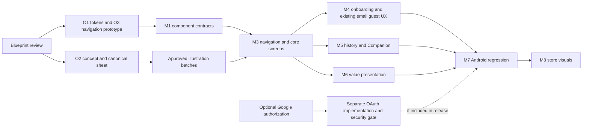

# Implementation roadmap

> **Owner decision update:** the mandatory-account/subscription target supersedes the optional freemium proposal below. See [sequential PR A/B/C migration and disabled rollout](../account-migration/PR_A.md). This document does not authorize enabling the new policy; A alone preserves current access and billing.

This is a sequence of **future scoped PRs**, not permission to change production now. Retain static JS/Netlify/Supabase/Capacitor. Source baseline and uncertainty labels are in [the audit](COMPETITIVE_AUDIT.md). No schema migration, new framework, auth/billing rewrite or feature-parity tracker is justified by the visual work.

## Dependencies

M1 can proceed with non-character component prototypes once O1 is approved. It must not generate a provisional mascot to bypass the O2 gate. M3 production art-dependent work waits for approved canonical art and tested composition. OAuth is optional and must not block email/guest improvements if deferred.

## Milestones and review boundaries

| Milestone | Deliverable / suggested scope | Depends on | Exit criteria and review evidence |
| --- | --- | --- | --- |
| **M0 — blueprint decision** | Review this Draft PR, resolve O1–O6, record open evidence | None | Owner approves direction/scope or requests revisions; assumptions remain labeled; no production changes |
| **M1 — foundations/components** | Token files, licensed font/icon assets, buttons/cards/scales/state panels and nav prototype, local theme/animation presentation preference design | O1, proposed O3 | Actual contrast/focus/target matrix; EN/UK/RU samples; reduced motion; no data/auth/billing edits. Prototype has no fake functional controls |
| **M2 — art approval** | Three concept boards → one canonical sheet → expression proof → optimized asset batches | O2 concept choice; M1 palette | Explicit owner version sign-off, adult/silhouette/originality checks, alpha/light/dark/mobile previews, weight/provenance inventory. **Gate before final mascot-dependent UI** |
| **M3 — navigation/core** | Home, check-in, Quick/Advanced symptoms, observation/follow-up and episodes, wrapping existing handlers | M1, M2 approved relevant assets, O3 validation | Named actions discovered in study; 320–430 px + large text; same stored payload/IDs/scales; offline edits and date/Back guards preserve drafts; no global sync banner |
| **M4 — onboarding/auth UX** | Three localized slides, skip/guest choice, focused existing email/login/recovery surface, explicit migration review | M3, O4, approved illustration batch | Fresh/returning/guest/account/offline paths; no implicit data merge; old onboarding flags/storage handled deliberately; no paywall before value. OAuth excluded unless separate gate passed |
| **M4b — optional Google OAuth** | Provider setup specification, PKCE/native/web callbacks and identity linking in a separate auth PR | O5 authorization and owner provider settings | All callback/replay/cancel/process-death/account-switch tests; no automatic email-based merge or purchase transfer; email recovery stays valid; security review before exposing button |
| **M5 — history/analytics/Companion** | Calendar/list alternative, chart table/focus/legends, readable context capsule/source sheet and conversation states, existing report tools | M3, relevant M2 scenes | True gaps/counts/baseline threshold; selected bounded context/notes visible; no auto-send/retry; source revision errors and exports; no new causal-analysis claim |
| **M6 — Premium presentation** | Value/plan state hierarchy and contextual opt-in offer, not new billing infrastructure | M3, O6, approved Premium art | Real offerings/pricing phases; native vs web separation; pending/restore/manage; no local Premium flag; all existing quotas/ownership/grace checks intact |
| **M7 — Android regression/release verification** | Existing Actions debug/internal builds and staged manual acceptance; focused accessibility/usability review | M3–M6; M4b only if included | Checklist in acceptance criteria, real TalkBack/font/back/keyboard/process tests, owner Play purchase evidence, data preservation, safe-area behavior. Existing release workflow retained |
| **M8 — store listing** | Six localized screenshots, adaptive icon/feature graphic, final owner Console review | M2 and M7 signed-off actual UI | Screens depict implemented features with synthetic data; text/claims/privacy consistent; no invented ratings, prices or provider validation; owner uploads/publishes separately |

Durations are deliberately not estimated before art revisions, owner availability, device access and O5 scope are known. Parallel design work means independent human workstreams, not permission for unattended code changes. Use small reviewable PRs per milestone; do not bundle auth changes into a CSS review.

## Rollout and preservation strategy

1. Freeze a baseline set of synthetic guest/account A/B records and exports; include old numeric entry IDs, episodes, check-ins, pending/conflicting records and saved chat receipts. Do not use production health notes as test fixtures.
2. Build presentation primitives alongside existing model/transport interfaces; preserve handler entry points or adapt them explicitly with regression proof. Keep one source of truth for copy/tokens instead of adding another stylesheet of overrides indefinitely.
3. Add screens in route-sized batches; compare exports and payloads before/after. A visual rollback must not require rolling back a schema or deleting local storage. Any newly proposed presentation preference is versioned separately from journal data and account entitlements.
4. Run proportional checks per batch: component/static checks for tokens, targeted browser flows for screen changes, full regression and real Android/billing gates for release. A docs-only edit does not justify rerunning the Android/SQL fleet.
5. Keep store-dependent claims gated by actual owner configuration and internal tests. Prior billing CI proves code compilation/fixtures, not live payments. Do not close issue #15 or the previous user-feedback/Android gate from a design approval.
6. Release only after owner review of staged evidence; merge/deploy/Play rollout require their normal explicit action. This PR performs none of those actions.

## Risks, mitigations and scope control

| Risk | Mitigation / stop criterion |
| --- | --- |
| Art drifts into a Bearable recolor or childish plush toy | Reject at M2 originality/adult-comfort gate; do not average away that failure |
| Expressive UI obscures data or slows entry | One dominant action, limited mascot zones, ordinary-day and fatigue tasks; remove decoration before shrinking text |
| A new scale reinterprets old records | Keep exact 1–5 dimensions and entry-level 1–10 severity; no migration for visual choices |
| Calendar/graphs look accessible but fail assistive use | List/table equivalents, TalkBack/focus/200% font tasks; block release on unreachable data/actions |
| Google appears finished because its button exists | O5 separate auth gate, hidden entry point until supported and tested |
| Paywall implies local authority or a fake trial | Keep backend/server ownership and store data; screenshot/error-state review with existing billing suite |
| Color/theme update strands current users | Approve transition, preserve existing dark experience/preferences and test both themes, never clear data |
| Too much “parity” expands roadmap indefinitely | Defer custom metrics/body map/reminders/wearables/causal inference until separate validated product work |

Owner decision ledger should record O1–O6, chosen canonical asset version, prototype feedback, unresolved accessibility/billing/device evidence, and the exact release commit. An empty box is an open requirement, not implicit approval.
