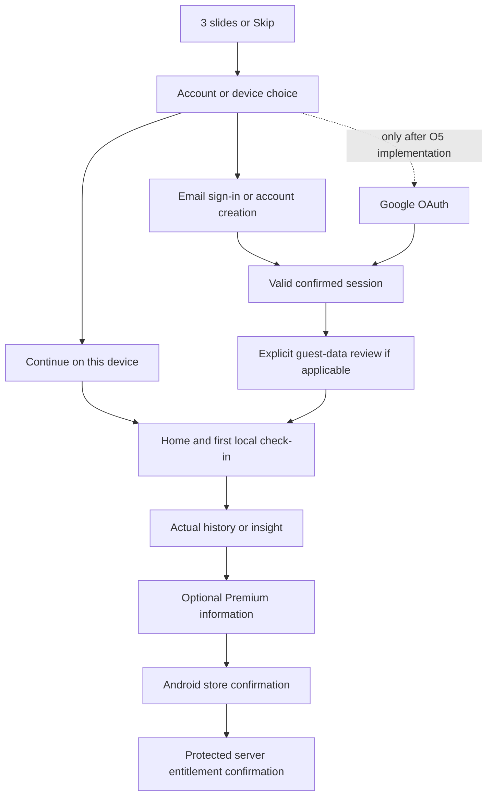

# Onboarding, account and Premium journey

**Design proposal only.** The current app already has email/password, guest/device storage, explicit merge, protected billing and native store integration. It does **not** have Google OAuth or a three-slide illustrated onboarding. Preserve working flows; the design does not authorize configuring providers, modifying secrets or changing production.

## Three-slide onboarding

Language and Skip are available from slide one; Back/Next, visible “1 of 3” progress and accessible announcements are consistent. One illustration zone above one headline/body; text never lives in an image. At large text, allow scroll and reduce/hide decorative art before truncating functional content. Save onboarding completion separately from journal data; a returning-user update must not erase/re-run account migration. “Skip” reaches the same account/guest choice, not a hidden subscription offer.

| Slide | Proposed EN | Proposed UK | Proposed RU | Illustration / next action |
| --- | --- | --- | --- | --- |
| 1 — ordinary days | **Your ordinary days matter.** Four quick choices for wellbeing, mood, energy and sleep. Add a note only if you want. | **Звичайні дні теж важливі.** Чотири швидкі оцінки самопочуття, настрою, енергії та сну. Нотатка — лише за бажанням. | **Обычные дни тоже важны.** Четыре быстрые оценки самочувствия, настроения, энергии и сна. Заметка — только по желанию. | `ill-onboard-01`; Next / Далі / Далее |
| 2 — difficult days | **A clearer record of difficult days.** Add symptoms when they happen and group your recovery into an episode. | **Зрозуміліша історія складних днів.** Додавайте симптоми, коли вони виникають, і об’єднуйте відновлення в епізод. | **Понятнее история сложных дней.** Добавляйте симптомы, когда они возникают, и объединяйте восстановление в эпизод. | `ill-onboard-02`; Next, Back |
| 3 — control and context | **Choose what you share.** Keep a record on this device, or use an account for cloud sync. Companion sends selected context for AI processing only after your confirmation. | **Вибирайте, чим ділитися.** Зберігайте записи на пристрої або використовуйте акаунт для хмарної синхронізації. Companion надсилає вибраний контекст на AI-обробку лише після вашого підтвердження. | **Выбирайте, чем делиться.** Храните записи на устройстве или используйте аккаунт для облачной синхронизации. Companion отправляет выбранный контекст на AI-обработку только после вашего подтверждения. | `ill-onboard-03`; Choose how to continue / Вибрати спосіб продовження / Выбрать способ продолжения |

No “nothing leaves your device” claim, mandatory diagnoses/medical history questionnaire, data-import promise, immediate paywall or trial opt-in. The illustration must not imply that all data is shared automatically. Groq/AI consent remains separately detailed at the real sending step; this slide is not substitute consent.

## Account choice and first value

At the choice screen, Google may be the leading account CTA **only once fully configured/tested**; email remains an equally findable alternative, guest is explicit rather than hidden text. Before O5, show email and guest only. Account copy explains that local data is device-only until a reviewed merge/sync; an unconfirmed email signup is not cloud-save success. Password reset/confirmation continues to the existing configured web origin; after completion the user returns to Android and signs in. No deep-link continuity is assumed from the current build.

First successful local check-in leads back to today's saved state, not another setup wall. Account benefit can be a small dismissible “Keep this account in sync” explanation later, never a claim of backup when the user is offline/unconfigured. The existing no-global-sync-banner decision remains.

## Guest migration and account switching invariants

- Switching into an account first shows that account's partition, not a silently merged guest journal.
- If a device journal exists, provide a bounded summary of record types/counts and **Merge device journal** vs **Not now**, using the current consent/migration path. Do not implement a new blanket “replace cloud” choice.
- Existing stable IDs, retries/fingerprints, outbox, version conflicts and archived originals remain intact. A visual redesign must not clear storage to simplify onboarding.
- Guest chat drafts do not migrate automatically. Account A→B→A must invalidate stale form, chat, auth and purchase callbacks; the currently visible account determines every message and verified status.
- Merge/storage/sync failure preserves originals, shows recovery export/retry, and cannot be disguised by a celebratory character. A different provider identity may represent a **different account**, not an entitlement transfer.

## Optional Google integration: separate engineering gate O5

Audit evidence: `js/supabase-auth.js` calls `signInWithPassword`/`signUp`; there is no implemented Google provider or native return listener. The existing Capacitor Browser/App plugins and persisted Supabase session are useful building blocks, not a completed OAuth flow.

A future implementation must decide and test:

1. Owner enables Google provider in Supabase and configures appropriate Google web/Android client IDs, consent screen and redirect allowlists. Private client secrets stay in provider settings; do not put them in native assets or this PR.
2. Use the official browser/provider flow rather than an embedded Google login form. Select one supported Supabase PKCE strategy with the verifier preserved across native background/process transitions. Do not infer that a web-origin callback signs in the separate native origin automatically.
3. Choose an owner-controlled verified HTTPS App Link (preferred if available) or a specifically reviewed native callback scheme. Register exact hosts/paths, Android package and applicable certificate fingerprints; verify Play **app-signing** vs upload-key fingerprints. Existing email recovery URLs must keep working.
4. Implement validation of callback origin/path, PKCE/state and a one-time code exchange through the supported Supabase SDK; reject unrelated links, replayed/cancelled/expired callbacks, wrong-account results and stale generations. Tokens/codes must not be logged, placed in screenshots or accepted from arbitrary navigation.
5. Define explicit account-linking/recovery behavior for email and Google. Do not merge journals or purchases by comparing email strings. Retain RevenueCat's original-owner policy and immutable transaction ownership.
6. Test web, debug Android and Play-installed internal builds: cancelled chooser, no Google account, network loss, process death, return from browser, repeated callbacks, A/B switching and existing guest data. Hide/disable the Google entry point until this gate passes.

No provider IDs, app domains, callback URL or credentials are invented here. Declining O5 does not block improving the email/guest onboarding or shipping the rest of the visual redesign.

## Contextual monetization

Preferred entry: the user's explicit request for an existing Premium filter/90-day comparison, Settings → Premium, or an optional card **after a genuinely useful recorded-data insight**. No automatic modal after first save, no paywall on export/delete, and no upgrade demand when a provider/global budget outage prevents AI.

Proposed optional card rule (O6): one dismissible card after a real insight, no repeated appearance in that session; a local “not now” preference can suppress it for 30 days if separately implemented/reviewed. This preference is presentation-only and must never be an entitlement source or a new health-telemetry event. Do not draw a working cooldown control before implementation.

| Free always | Premium value that already has an implementation basis |
| --- | --- |
| Check-ins, symptom entries, recovery episodes and complete history | Advanced symptom filtering and the existing 90-day comparison |
| Essential weekly statistics and eligible baseline | More longitudinal comparison context, not a causal engine |
| Selected context/full-account export and deletion | Larger server-configured chat/report allowances, not unlimited AI |
| Current Free provider allowances, if AI is enabled | Existing report/visit-question tools with a larger allowance, not a new clinician portal |

The paywall shows actual server enablement/allowances and unavailable states. “Richer visit preparation” means the implemented AI report/questions and export; generated content is not clinically validated. Never imply that payment fixes unavailable model/configuration or guarantees a diagnosis.

### Billing state contract

Retain `js/billing/client.js`, protected routes and [the billing guide](../premium-billing.md) as the implementation authority. This task changes no RevenueCat behavior.

| State | Presentation/action |
| --- | --- |
| Verified Free, Android offers available | Real Monthly/Yearly option, store prices, full phase/renewal disclosures, named store subscribe action |
| Web | Verified status and management information; no native billing launch or fake web checkout |
| Product/config/offline failure | Honest unavailable explanation, core app access and recovery; no dummy price/trial |
| Store chooser cancelled | Calm return; no success or punitive mascot |
| Price/eligible offer changed | Refresh store terms and ask the user to review before purchase |
| SDK success, server not confirmed | Pending; disable repurchase, offer status/restore; no Premium success based on `CustomerInfo` |
| Server-confirmed paid/cancelled with remaining access | Actual validity and management link; no immediate downgrade simply for cancellation |
| Grace | Follow the server's corroborated V1/V2 checks; a grace date alone cannot grant Premium |
| Expired/refunded-and-revoked/held | Server result controls access/allowance; restore/management remain available |
| Restore on account B for account A's purchase | Explain original-account requirement; never transfer purchase ownership in the UI |

No prices/currencies/trial durations/discounts are assigned by this design. Eligible phase text and the actual purchase option must remain identical. Subscription terms, cancellation, privacy and restore are visible and localized; deleting the Ambrosia account does not cancel Google Play auto-renewal or erase external transaction records.
