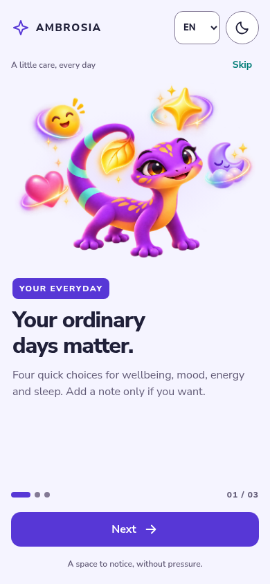
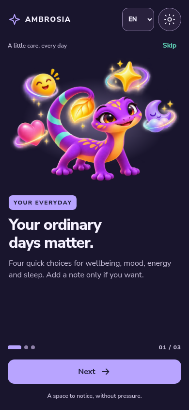
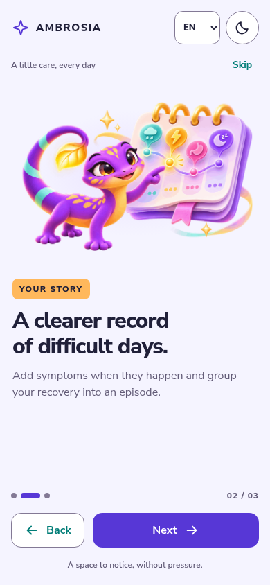
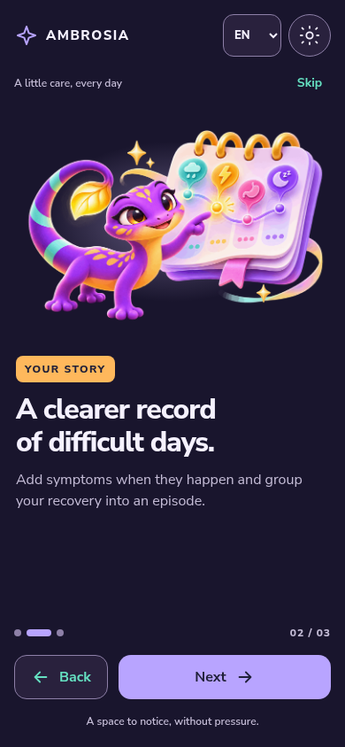
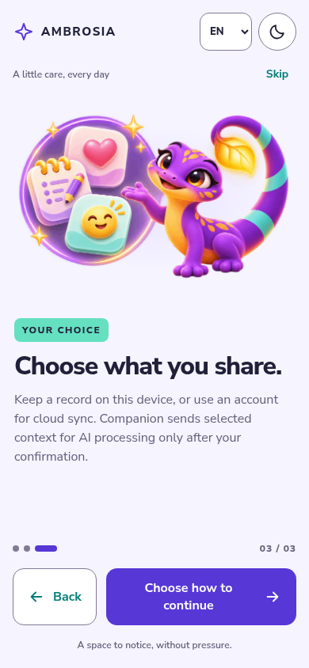
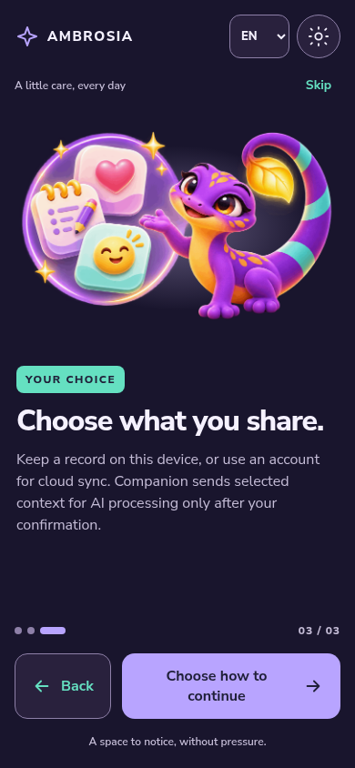
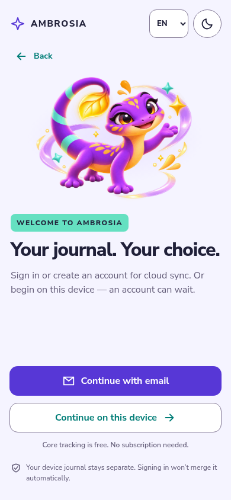
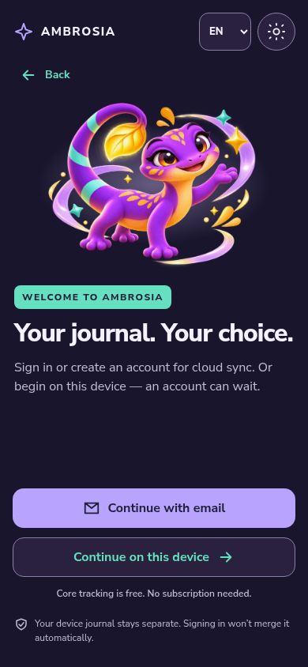

# Ambrosia 3.0 Phase 1 — Ari, foundations and onboarding

Implemented from the approved [PR #22 blueprint](https://github.com/themightydanik/ambrosia/pull/22), already merged into main. PNG-only owner instructions override the blueprint's WebP/optimization suggestions. This phase changes welcome/onboarding presentation, not the journal, cloud persistence, AI or billing rules.

## What changed

- Opt-in 3.0 foundations: electric iris/apricot/aqua/rose/ink tokens, light/dark surfaces, local licensed Nunito Sans with Latin/Cyrillic subsets, consistent 24 px outlined icons, reusable buttons/badges/illustration frames, visible focus and reduced-motion rules.
- Three illustrated, localized slides with visible progress, Next/Back/Skip, language/theme controls and real DOM copy. Only the currently visible image is mounted/requested.
- Skip and slide three reach the **same** account choice using the approved auth illustration. Guest continuation and email signup/sign-in/reset reuse the existing data/auth paths. There is no Google OAuth button or new provider/callback configuration.
- The existing `ambrosia_onboarding_done` marker is retained. Returning users bypass the introduction; no reset, forced migration or journal conversion. Initial journal/session setup runs as before; welcome can paint while it runs, but account/guest continuation waits until it completes. A language chosen during that interval is retained without prematurely writing the journal.
- Account-only and device-only journals stay separate until the user explicitly merges through existing Settings. A confirmed email signup is not represented as a signed-in/cloud-synced session. No auto-merge or account switching changes.
- Reusable decorative illustration component and registry support all ten approved scenes. Companion/Premium/empty-state scenes are ready for later consumers, not inserted into or used to redesign those destinations now.

## Asset and build packaging

[Exact PNG inventory, original dimensions, transparency and byte budgets](ASSETS.md). All **23** release assets are preserved byte-for-byte; 21 have actual transparent alpha, two opaque RGB files are reference sheets. All 23 published release digests match. Eleven unused poses and both reference sheets live in `source-assets/ari/v1/`, outside runtime outputs.

`npm run build` creates the allowlisted `web-dist` static application. Netlify now publishes that directory and retains the same Functions path, API redirects, security headers and scheduled billing function. This packaging change prevents source references/test files from being part of the application bundle. Native asset preparation uses the same allowlist; no native release workflow or signing behavior changes. The optional Vercel preview explicitly uses the same `npm run build` / `web-dist` static output via `vercel.json`; `.vercelignore` excludes the source archive from uploads too. Netlify remains the existing function/API host.

Visible art is eager/high priority with asynchronous decoding and explicit dimensions; other scenes are not prefetched. Future illustration consumers default to lazy loading. No art enters service-worker install precache; only requested/visited images are cached once controlled. All essential text/actions work when art fails. The new welcome uses local fonts; the old Google Fonts stylesheet is loaded only on entering a legacy destination, rather than blocking welcome paint.

## Screenshots

Actual running web implementation at 390×844; no mockup images, credentials, user health data or store prices. PNGs below are UI screenshots, not resized/recompressed character assets. The focused suite additionally checks all four surfaces at 320/375/390/430 px in EN/UK/RU and both themes.

| Screen | Light | Dark |
| --- | --- | --- |
| Slide 1 |  |  |
| Slide 2 |  |  |
| Slide 3 |  |  |
| Account choice |  |  |

To refresh deliberately: `npm run build`, then `UPDATE_SCREENSHOTS=1 npm run test:onboarding` with Playwright available. Ordinary runs write to `/tmp/ambrosia-phase1-screenshots`; CI uploads those images alongside the legacy suite's artifacts. Never place production journal/credential screenshots into this directory.

## Verification

- `npm run build`: succeeds; exact unpacked output and PNG payload are recorded in [ASSETS.md](ASSETS.md). This is a static production web build, not an Android APK/AAB size or a live deployment.
- `npm test`: **129 passing** unit/model/handler/asset tests. New asset tests check all original PNG hashes/dimensions and runtime source exclusions.
- `npm run test:onboarding`: focused browser matrix covers four surfaces × four widths × three locales × two themes; navigation/final-vs-skip equivalence; initialization gating and pending language; signup confirmation/reset/sign-in; unchanged guest originals/no implicit merge; returning-user bypass; completion/theme persistence; offline guest reload; failed-art fallback; large text/reduced motion; no JS errors.
- Existing `npm run test:browser`: passes wellness, chat, sync, billing/auth/privacy, conflict, offline, export/deletion and legacy numeric-ID scenarios with simulated external services. It was run once for presentation/bootstrap regression; this does not claim real provider/device acceptance.
- Locally decoded all 23 PNG files with Pillow: original sizes and actual alpha extrema match the inventory. No image conversion tool was used.
- `git diff --check` and protected-file diff review: no database, Netlify function, billing/entitlement, sync transport/store, consent or Android release-workflow changes. The existing CI gains only the focused onboarding/build check and screenshot artifact path.

No live SMTP/Supabase login, Google OAuth, Groq purchase-related state, real Play transaction, SQL migration or production configuration was exercised/changed. The SQL suite was not manually rerun for unchanged backend/schema. No Android APK/AAB or release was manually generated for this phase.

## Known limits

- Original PNG quality has a cost: first illustration is 1.74 MB; ten runtime scenes total 5.31 MB. Six prepared future scenes add bundle storage but no welcome network requests. No lower-quality/alternative-format derivative has been substituted.
- Theme/foundation rollout is intentionally scoped to onboarding/account choice. Home/history/Companion/Premium/Settings keep their existing destination designs and dark palette. Returning users' existing experience is preserved; a global theme-setting destination is a later phase.
- Real TalkBack, physical Android font/display scaling, keyboard/system Back and bank-app transitions require the manual checklist below. Browser emulation is not equivalent to device approval or an independent WCAG audit.
- A first-ever offline web visit cannot install the application. An unvisited uncached scene can lack art offline; text/navigation/journal remain functional. Native runtime images will be bundled locally. Storage-blocked browsers retain the pre-existing completion-marker limitations; no journal is cleared to fix them.
- Email/provider availability and password/confirmation rules are unchanged. Google OAuth is still absent; this phase does not implement deep links or account linking. Ari's release-approved anatomy, colors, glows and alpha are used as supplied, without retouching.

## Android manual verification checklist (owner/tester, after review)

Use an already available approved **debug/internal test build**, or request a separately authorized build. This task does not request a Play release or generate an Android release.

- [ ] Clean install: three illustrated slides at real device sizes, language control, progress and Next/Back/Skip; system bars/gesture safe areas do not cover controls.
- [ ] Light/dark, reduced motion, Android large font/display scale and TalkBack: readable labels, focus/step announcements, no clipped controls or stretched/cropped Ari.
- [ ] Existing installation update: stored completion bypasses onboarding, journal/account partition remains present, no forced merge/migration.
- [ ] Offline guest launch/save/reload/reconnect: original journal intact; only existing safe merge controls can move device records into an account.
- [ ] Email signup confirmation/reset/sign-in/sign-out: correct provider/email flow, no fabricated Google option; native resume/process restart retains the existing session semantics.
- [ ] Keyboard and system Back on the email form: controls remain reachable; existing native Back behavior is unchanged in this phase (future dirty-form/Back improvements remain separate work).
- [ ] Home/symptom/episode/history/Companion/export/deletion and Premium management regression on the same account; no cross-account art/status callback leaking record data.
- [ ] No new SDK-based purchase, entitlement bypass, signing, notification or cloud-configuration behavior. Any real billing check follows the existing owner-controlled internal checklist, not this visual PR.

## Proposed next phase

Owner review of these actual screens first. Then adopt the approved foundations in Home/check-in and navigation using the existing model/persistence handlers, with the approved standalone Ari poses selected deliberately. Roll out Companion/Premium/empty-state illustrations in their separately reviewed screen phases. Retain the original PNGs unless the owner explicitly approves a later asset-format/performance change. Google OAuth and native dirty-form/Back work remain separate scoped integrations, not cosmetic side effects.
