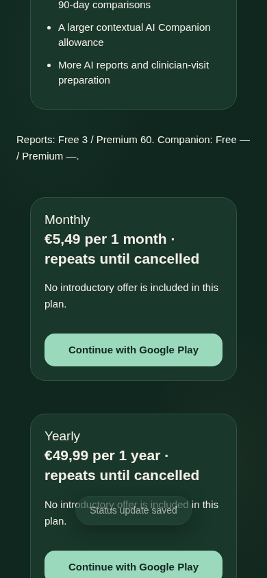

# Google Play Premium — owner setup and internal testing

This change implements billing code; it does **not** create products, charge customers, apply production SQL, merge, release to Google Play or validate a real purchase. The owner must complete the dashboards below. No invented production identifiers, prices, currencies, trials or credentials are in the repository. Issue #15 remains open until real internal-track validation is complete.

## Architecture and supported versions

Official documentation and npm package metadata were checked on 26 October 2026:

- [RevenueCat Capacitor installation](https://www.revenuecat.com/docs/getting-started/installation/capacitor): official `@revenuecat/purchases-capacitor` **13.7.6**, requires Capacitor ≥8. Its shipped Android Gradle configuration uses `purchases-hybrid-common:19.15.0`.
- Capacitor `core/android/cli` **8.5.3**, App **8.1.0**, Browser/Share **8.0.3**, Filesystem **8.1.5**; matching core/android versions and Node ≥22 for CLI. The lockfile pins resolved dependencies. Native build uses Node 24, Java 21, Android compile/target 36, min 24 and the Capacitor-generated Gradle wrapper.
- [Customer identity](https://www.revenuecat.com/docs/customers/identifying-customers) and [restore behavior](https://www.revenuecat.com/docs/projects/restore-behavior): configure an identified customer initially, never anonymously. Switching directly between custom IDs does not intentionally merge them. **Keep with original App User ID is a mandatory dashboard setting**, not something an SDK can enforce by itself.
- [Webhook authentication and retry semantics](https://www.revenuecat.com/docs/integrations/webhooks), [event fields](https://www.revenuecat.com/docs/integrations/webhooks/event-types-and-fields), [authenticated server API v1](https://www.revenuecat.com/docs/api-v1) and its [Customer Info schema](https://www.revenuecat.com/docs/api-v1/customer-info-model). V1 remains documented for server-side status checks; only the private secret API key is used server-side. The schema's `store_transaction_id` is used; an imaginary `original_transaction_id` field is not required.
- [Google subscription lifecycle](https://developer.android.com/google/play/billing/subscriptions) and [test purchases](https://developer.android.com/google/play/billing/test). A debug APK is not evidence of a successful Play purchase.

The ordinary web app remains a static Netlify app. Native builds bundle the existing UI locally, plus the official SDK bridge; they do not point a privileged WebView at remote app code. Capacitor permits no additional WebView navigation origins, HTTPS cleartext is disabled, `singleTop` preserves banking-app purchase transitions, Android backups are disabled, and an embedded CSP restricts web requests. Only native code imports the bridge. Native `/api` requests use the one build-configured HTTPS Netlify origin, with bearer authentication; APIs allow the exact native origin `https://localhost`, not arbitrary CORS origins. Journal, chat and account flows retain their existing Supabase RLS and offline storage.

An authenticated confirmed-email user receives a random server-created `rc_<uuid>` customer identifier. It maps one-to-one to a Supabase user but exposes no email or health content. SDK operations are serialized and check account generations before/after awaits. On logout the SDK is left idle; it is never allowed to purchase anonymously. The next operation identifies the new custom account explicitly. A late purchase result cannot refresh or announce success for the newly signed-in user.

`POST /api/billing-refresh` accepts **only** the expected authenticated user ID. It never accepts a tier, receipt, price, entitlement, transaction or success flag. The backend reads RevenueCat's subscriber using its secret, validates original customer identity, the configured entitlement, explicit product allowlist, Play store, environment, finite expiry and verified transaction. A normalized Play order-root SHA-256 fingerprint has immutable ownership, independent of client identifiers. SDK `CustomerInfo` does not grant access.

Premium remains `entitlements` → existing server account snapshot → existing report/chat quotas. Billing does not reset consumed AI usage, lift global budgets or bypass rate limits. Cancellation retains paid access until verified expiry. Trials use the verified trial state. Grace extends access only when the current RevenueCat snapshot corroborates an active grace period as described below. Expiration/revocation removes access. A refund alone does not necessarily revoke the remaining paid period; RevenueCat’s current expiry determines that, while refund-marked periods cannot receive a grace extension. Missing configuration or malformed/unverified responses cannot grant Premium.

### Grace verification and contradictory snapshots (PR #21 correction)

Rechecked the official [API v1 schema](https://www.revenuecat.com/docs/redocusaurus/openapi-v1-customer-info-model.yaml), [Billing Issues & Grace Periods](https://www.revenuecat.com/docs/subscription-guidance/how-grace-periods-work), [CustomerInfo semantics](https://www.revenuecat.com/docs/customers/customer-info#get-entitlement-information) and [cancellation/expiration reasons](https://www.revenuecat.com/docs/integrations/webhooks/event-types-and-fields#cancellation-and-expiration-reasons) on 26 October 2026. The schema describes grace dates as potential/historical, while the lifecycle guide says recovery clears them. `billing_issues_detected_at` clears on resolution. Therefore neither a lone grace date nor a `BILLING_ISSUE`/`CANCELLATION` event is sufficient proof of present grace. V1 has no explicit `is_active`, `account_hold` or `revoked` flag in these objects; no such invented fields or SDK assertions are trusted. The [V2 subscription model](https://www.revenuecat.com/docs/api-v2/subscription-data-model) explicitly provides `gives_access` and lifecycle `status`; `in_billing_retry` means access is suspended, while `in_grace_period` describes access-granting grace.

The default verified deadline is the **earlier** of entitlement and subscription `expires_date`. Grace is used **only after that paid period has ended**, and only if all of these agree in fresh authenticated provider responses:

- The selected entitlement and Play subscription have identical paid expiries and identical, finite current-period `purchase_date` values.
- Both objects contain the **same future** `grace_period_expires_date`, after the paid expiry.
- The subscription has an unresolved, valid `billing_issues_detected_at` from this purchase period, not later than the provider request timestamp or the server clock.
- There is no refund marker or pause/resume marker. Product, original owner, store, environment and transaction-fingerprint verification still apply.
- An additional authenticated [V2 list-subscriptions request](https://www.revenuecat.com/docs/api-v2/customer/resources#tag/Customer/operation/list-subscriptions) confirms **exactly one** subscription for the same original/current customer, Play environment, purchased ownership, order root, current period and configured entitlement: `gives_access === true` **and** `status === "in_grace_period"`. Its finite current-period end must lie between the V1 paid expiry and grace deadline. A status such as `in_billing_retry`, `paused`, `expired`, `unknown` or plain `active` cannot establish extra grace, even if it contradictorily says `gives_access: true`.

The V2 lookup runs only for corroborated V1 grace candidates after paid expiry; normal paid/cancelled/trial access still uses V1 and the existing ownership checks. Missing V2 configuration/permissions, request failure/throttling, malformed responses, ambiguous matches and a paginated/incomplete result all deny the extension. The code requests at most 100 subscriptions and never follows provider-supplied pagination URLs. It **applies the expired paid deadline** rather than preserving an old overlong grace grant. Scheduled/native reconciliation can restore legitimate grace once the private V2 check succeeds. No client-supplied V2 proof is accepted.

This is deliberately conservative: missing or inconsistent corroboration denies an extra grace extension, even if the provider guide's basic single-field check might be more permissive. It does not delete the paid remainder or manufacture an extension in advance. Reconciliation retries can recover access once RevenueCat returns a consistent current state. A valid resolved snapshot with residual grace is **applied with the paid deadline / expired state**, not thrown away as a network failure that would preserve an older overlong grant. Malformed core expiry fields are rejected without inventing access.

| Observed verified state (V1 and, for extra grace, V2) | Access decision |
| --- | --- |
| Auto-renewal cancelled, paid expiry still future | Retain only that paid period. Cancellation may also accompany genuine grace; it is not itself a revocation. |
| Billing issue, paid period still future | Retain only that paid period; do not pre-grant potential grace. |
| Paid period ended, all current grace evidence agrees | Retain through the matching grace deadline, still requiring the original purchase owner. |
| Resolved/missing/future/old-period billing issue, one-sided or mismatched grace, period mismatch | Ignore grace; use the earlier paid expiry. |
| Account hold, exhausted/no grace, expired or removed entitlement | No Premium after paid expiry. A future resume date does not grant access during a pause/hold. |
| Refund without revocation, authoritative paid expiry remains future | Retain that paid remainder; do not extend with residual grace. RevenueCat explicitly warns refunds need not deactivate auto-renewal/access. |
| Refund **with** revocation, or revocation without refund | Earlier authoritative expiry/removed entitlement denies access, even if a residual grace field or conflicting future expiry remains. |

The existing freshness, generation, idempotency, private-key verification and immutable purchase-ownership controls are unchanged. As before, state cannot become fresher than Google/RevenueCat reporting; when the main V1 lookup itself fails, only the last verified bounded grant is available until its known expiry. If V1 succeeds but the required V2 grace check fails, the fresh V1 paid deadline is applied without any grace extension. No live dashboard, webhook or production database was changed by this correction.

## 1. Choose identifiers and create products — owner only

In **Google Play Console**, use the existing app/package if one already exists. Otherwise choose the permanent Android application/package ID yourself before creating the listing. Record that exact ID; changing it later creates a different app.

1. Complete the Play developer/payment profile and app requirements necessary for internal subscription testing. Enable Play App Signing and obtain/protect the app's **upload key**. An upload key and Google-managed app-signing key are different; do not rotate either casually.
2. Under **Monetize → Products → Subscriptions**, create **two separate subscription products**, one Monthly and one Yearly, each with one active **auto-renewing** base plan (`P1M` and `P1Y`). Select prices, countries, grace/account-hold policies and optional offers in Play yourself. This version deliberately rejects prepaid/installment plans.
3. Record the two **subscription IDs** and base-plan IDs. `REVENUECAT_PRODUCT_IDS` contains the two subscription IDs in **monthly,yearly order**. The native store option also includes its base-plan ID. If the current RevenueCat dashboard/API represents a configured product differently, confirm the actual `product_identifier` and option `productId` in sandbox first; never loosen the allowlist to make an unknown product work.
4. Add license testers under **Settings → License testing**, and add the same accounts to the app's internal-track testers. A tester must install through the opted-in Play testing link using the correct Play account. Do not use a real personal payment method for test purchases.

Do not create a public production release as part of this task.

## 2. RevenueCat dashboard — owner only

1. Create/select the appropriate project and connect its **Google Play Android app**, using the exact package ID. Follow RevenueCat's current Play service-account/Android Publisher setup and grant the required app permissions through Play Console. Upload the JSON credential **only to RevenueCat**, never to this repository, client, artifact or Netlify public configuration. Configure Google real-time developer notifications as instructed by RevenueCat so renewals/refunds are reported promptly.
2. Import the two Play products/base plans. Create/select your Premium **entitlement ID**, attach both products and record it. Create/select your **offering ID** and add exactly one Monthly (`MONTHLY`) and one Annual (`ANNUAL`) package for this app. Both must have valid store-returned auto-renewing options. The app chooses this explicit offering; it does not silently purchase an unrelated current offering.
3. Under **Project settings → General → Restore behavior**, choose **Keep with original App User ID**. Do not use transfer/share behavior. This is required for correct account ownership; test it with two Ambrosia accounts on one Play account before release.
4. Record the Android **public SDK key** (`goog_…`). Create a **private secret API key** (`sk_…`) authorized to read subscribers via REST API v1. For grace verification, record your RevenueCat **Project ID** (`proj…`) and create/authorize a V2 secret key with **`customer_information:subscriptions:read`** for that same project. Store it as `REVENUECAT_V2_SECRET_API_KEY`, or reuse the existing private key only if it supports that V2 permission. Keep all secret keys only in Netlify function secrets. Public SDK keys are not entitlement authorities.
5. Create a webhook integration with endpoint `https://<your-reviewed-Netlify-origin>/api/revenuecat-webhook`. Generate a strong random authorization value of at least 32 bytes (for example a random `Bearer …` header) using your password manager, and put the **identical full header value** in RevenueCat and Netlify. Subscribe to all lifecycle events, including transfers and future extensions; select the matching sandbox/production environment. Test from the dashboard; a dashboard TEST event alone does not demonstrate a verified purchase.

Never paste secrets into a GitHub issue, workflow input, commit, screenshot or AI conversation.

## 3. Supabase SQL Editor — owner action after review

In the **existing Supabase project**, confirm migrations 001–005 already succeeded. Back up through your usual Supabase workflow. Open **SQL Editor → New query**, copy the complete reviewed `supabase/migrations/006_google_play_billing.sql` and click Run **once**. It is transactional and additive; do not rerun old migrations.

New tables `billing_accounts`, `billing_events` and `billing_ownership` all have RLS enabled and no browser-role read/write grants. All new billing RPCs are service-only. Owner exports are extended through the existing authenticated export function. Old journal/chat RLS and migrations are unchanged.

Check Table Editor and function definitions, but do not treat a privileged SQL Editor read as an RLS test. Automated tests use disposable PostgreSQL; use expendable designated accounts for live checks, never production health notes.

## 4. Netlify environment — owner only

Use the existing Supabase function variables (`SUPABASE_URL`, `SUPABASE_PUBLISHABLE_KEY`, **private** `SUPABASE_SERVICE_ROLE_KEY`) and existing Groq/AI settings unchanged. Set these additional function variables, scoped to the intended deploy context:

| Variable | Exact owner-supplied value |
| --- | --- |
| `REVENUECAT_ANDROID_PUBLIC_KEY` | Android `goog_…` SDK key for this app |
| `REVENUECAT_SECRET_API_KEY` | Private `sk_…` key authorized for the V1 subscriber API |
| `REVENUECAT_PROJECT_ID` | RevenueCat `proj…` ID for this app; required for extra grace access |
| `REVENUECAT_V2_SECRET_API_KEY` | Private V2 key with `customer_information:subscriptions:read`; optional only if the V1 key also supports that V2 permission. Missing/failed V2 proof denies extra grace, not the verified paid period |
| `REVENUECAT_ENTITLEMENT_ID` | Premium entitlement ID from RevenueCat |
| `REVENUECAT_OFFERING_ID` | Explicit offering ID containing Monthly and Annual packages |
| `REVENUECAT_PRODUCT_IDS` | Monthly subscription ID, comma, Yearly subscription ID; no prices or base-plan suffix invented here |
| `REVENUECAT_ENVIRONMENT` | `SANDBOX` during internal tests; `PRODUCTION` only when deliberately enabling live billing |
| `REVENUECAT_WEBHOOK_AUTH` | Exact strong authorization header configured in RevenueCat |

Use a **sandbox deploy context** with sandbox webhook routing. Keep production credentials off untrusted PR deploys. One deployed backend accepts one billing environment; do not send sandbox and production webhooks to the same configuration. Use a dedicated reviewed staging/branch deploy and, when testing against an existing database, **expendable accounts that have no production subscription**: sandbox verification can replace that account's previous entitlement. Never switch a live production backend to SANDBOX just to test.

After owner deployment of the reviewed functions/config, check `/api/billing-session` and `/api/billing-refresh` require authentication, and webhook rejects missing/wrong authorization. Missing variables fail closed. The web paywall intentionally has no purchase/restore-native buttons.

### Lifecycle delivery and recovery

Webhook authorization is constant-time checked before DB access. Only bounded event metadata is stored; no raw payload, receipts, prices, health notes or provider tokens. Durable event IDs deduplicate completed events. Concurrent/incomplete deliveries get a retryable failure; no event is acknowledged complete before its known accounts have been freshly checked. The provider's current subscriber state, not the arriving event type/time, determines access. Thus a late expiration notification cannot overwrite a newer renewal. A per-account lease and generation guard reject stale workers; provider snapshot timestamps cannot move backward.

The scheduled `billing-reconcile` function runs **every minute**, selecting up to **25** accounts whose last attempt is older than five minutes. Attempts rotate fairly, including failures; malformed/failed accounts cannot permanently starve all others. This is a bounded job, not a promise that every account is checked each minute: for N accounts a pass requires at least `ceil(N/25)` minutes, and provider throttling/outages add delay. Native foreground, purchase and restore also explicitly reconcile. Monitor Netlify scheduled-function failures and RevenueCat webhook delivery/retry history; expand the queue/worker capacity before scaling beyond this small-release foundation. Webhook retries follow RevenueCat's documented limited exponential backoff, not an infinite delivery guarantee. Reconciliation is the fallback after that retry window.

An explicitly verified customer-identity mismatch revokes that account’s previous Google Play grant; it is not treated as a network outage. A provider outage preserves the last verified state only until its known expiry; no extension is invented. A refund's revocation reaches Supabase after successful webhook/reconciliation, not before Google/RevenueCat make it observable. Scheduled functions run on Netlify's published deploy; a branch/Deploy Preview does **not** prove the scheduled recovery worker is active. During staging, use the native Check status/Restore controls and inspect webhook deliveries. Confirm the schedule in the production dashboard after the owner-approved release.

## 5. GitHub Actions: build without a local CLI

No owner CLI installation is required. Review/merge the workflow through the normal owner process first; GitHub's manual workflow UI discovers workflows on the default branch. Then in the repository:

1. **Settings → Environments → New environment**, name it `android-internal`. Restrict reviewers/branches according to your normal release process.
2. Add environment **variables**: `GOOGLE_PLAY_APPLICATION_ID` (your exact package ID), `NATIVE_API_ORIGIN` (the exact reviewed HTTPS Netlify origin, **without trailing slash/path**).
3. Add environment **secrets** for signed internal AABs: `ANDROID_UPLOAD_KEYSTORE_BASE64`, `ANDROID_KEYSTORE_PASSWORD`, `ANDROID_KEY_ALIAS`, `ANDROID_KEY_PASSWORD`. Base64 is encoding, not encryption; keep the original keystore secure. Obtain the encoded file through your trusted key-management process. No app signing/API secrets belong in variables or workflow inputs.
4. **Actions → Android internal test build → Run workflow**, choose the reviewed branch/commit, `debug` or `internal`, a monotonically increasing Play **version code**, and a numeric version name. Debug builds need no upload key and are for UI/device smoke checks; they do not establish Play billing readiness.
5. Download the artifact from the run. For `internal`, upload the signed **AAB** manually in **Play Console → Testing → Internal testing → Create release**, review and roll out only to designated testers. The workflow never uploads, releases or changes Play products. Enroll through the tester link and install from Play.
6. GitHub CI independently builds a clearly synthetic `org.example…` fixture package against `https://example.invalid`, with no provider secrets/products. That compile artifact is not an owner app or release candidate.

Native generation is reproducible (`npm ci`, `android:prepare`); generated `android/`, `native-dist/`, Capacitor config, signing files and artifacts are ignored. The workflow generates a standard Capacitor activity/project and pins SDK versions. Native version codes and app IDs come from owner inputs, not a committed placeholder production identity.

Authentication uses the existing persisted Supabase password session. On foreground, automatic refresh resumes and billing is rechecked. Email confirmations/password-reset links intentionally go to the configured **web origin**, where the existing recovery UI works. Complete confirmation/reset there, then return to Android and sign in; no unregistered custom deep-link scheme or OAuth callback is claimed. Kill/reopen/resume and banking-app transitions must be exercised on a real device. Exports remain free: Android uses the native system share/save sheet instead of unsupported WebView blob downloads. Temporary exports live in private cache, are removed after a one-minute foreground timer, and the export directory is cleared on next native startup/account transition. Process death/background suspension can delay cleanup until that next startup. Test save/share destinations on real devices; files deliberately saved elsewhere are controlled by the chosen destination.

## 6. Internal end-to-end acceptance checklist

Use synthetic journal/chat data and designated accounts A/B. Keep screenshots free of keys/order numbers and personal health information.

- Verify Monthly/Yearly packages, the current locale/currency and every returned price phase against the Play confirmation sheet. Test an eligible introductory offer and an ineligible returning subscriber. No hardcoded trial, discount or “best value” claim should appear. Missing/misconfigured/prepaid/installment products must not expose a buy button.
- Free check-in, symptoms, complete history, basic baseline, export and deletion remain accessible. Free/Premium AI allowances match server configuration. Purchases do not reset already-used quotas or lift global limits.
- Purchase Monthly through Play. Before successful server confirmation, no success or new Premium appears. Then verify Supabase's `google_play` entitlement, both quota limits and richer analytics. Repeat with Yearly on a separate expendable account. Record real transaction lifecycle results in the release issue; fixture tests are not a substitute.
- Cancel the Play sheet: no Premium, no success message. Interrupt networking immediately after Play success: UI says pending, disables another buy and offers status/restore. Restore after reconnection/reinstall using the **same Ambrosia account**; verified access returns without repurchase.
- Exercise Google test accelerated renewal, voluntary cancellation (paid access remains), expiration, refund/revoke, billing failure/grace/account hold and recovery. Compare Play/RevenueCat/DB status. Grace never becomes perpetual access. Test a future residual V1 grace date against V2 `gives_access: false`/`in_billing_retry`, conflicting lifecycle status and wrong customer/transaction. Also disable V2 credentials/connectivity and verify the backend applies the expired paid deadline; restoring V2 verification must recover legitimate grace without repurchase.
- Resend the same webhook, deliver old expiration after renewal, temporarily break webhook auth, then fix it. Durable IDs prevent duplicate mutation; old events fetch the current state. Check retries and failed delivery visibility.
- Disable webhook delivery for an expendable subscription, change lifecycle state, then confirm scheduled reconciliation on the published test-capable deploy (or explicit status/restore in preview). Verify failures rotate and recover; observe capacity and provider limits before larger rollout.
- On one Play account, sign out of A, sign in to B and attempt restore/purchase. **Keep with original App User ID** must reject reassignment. B must never get A's paid access, health journal, chat or billing export. Switch A→B→A while a purchase is pending; the old callback must not announce success in another account.
- Try client/localStorage Premium flags and forged refresh inputs. Neither can alter the DB nor AI quotas. Wrong/absent webhook authorization must fail before provider or DB work. Repeat existing privacy, sync, chat and offline scenarios.
- Use Manage subscription to open the user's Play account. Explain cancellation is in Google Play, including before deleting Ambrosia. Account deletion removes linked billing state/events; external transactions/subscriptions are handled separately below.
- Test EN/UK/RU at 320/375/390/430 px and Android large text/keyboard/back/resume/process death. The native SDK is never launched in an ordinary web browser. Confirm the verified web Premium status for the same account.

## Export, deletion and external retention

Account export includes its server billing status and own sanitized event metadata, alongside the existing journal/chat export. Deletion cascades account billing state and strips its opaque ID from event subjects, deleting now-orphaned events. Restoring into a different account, including a replacement account after deletion, is deliberately blocked; contact the owner for an explicitly reviewed provider support process rather than expecting account deletion to transfer a purchase. A one-way transaction-root fingerprint remains **unlinked to the deleted account** to prevent later reassignment of the same purchase. It is neither an order receipt nor health content and is not a financial ledger. There is no automatic retention cleanup for those fraud-prevention tombstones in this version; review this disclosed retention with your privacy policy before live release.

Deleting Ambrosia does not cancel Google Play auto-renewal or automatically erase Google/RevenueCat transaction records. Google and RevenueCat may retain transaction records under their own policies/legal obligations. No universal legal retention duration is asserted here. Handle provider erasure requests through their documented dashboard/support process, account for mandatory financial retention, and keep health records out of billing-support correspondence. No legally required transaction ledger is newly created in Supabase by this PR.

## Validation evidence and remaining owner gate

**127 unit/model/handler tests passed**, as did the full browser and disposable SQL suites. A local Java 21 / Android 36 debug compile succeeded with all official billing/export plugins (245 tasks). This used a synthetic, unconnected package configuration, not an owner release app. Automated tests cover authenticated purchase confirmation, duplicate/old events, refund/cancellation/grace, restoration/network recovery, cross-account and spoofing protection, quota changes, exact native CORS and web/native separation. Actual disposable PostgreSQL exercises migration 006 after 001–005 and checks service-only grants, ordering, ownership fingerprints, export and deletion. Browser tests simulate the native SDK/store and external provider; they do not claim a real Play transaction. CI compiles the official native plugins without credentials.

**Remaining owner evidence:** real credentials/product mapping, signed internal-track installation, Play purchase/renewal/refund/grace/restore results, dashboard ownership policy, function/webhook/schedule operation and the complete device checklist above. Only after those pass should issue #15 and the Google Play 1.0 billing gate be considered complete. No production entitlement has been activated by this coding task.

