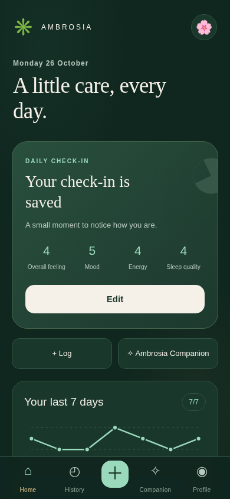
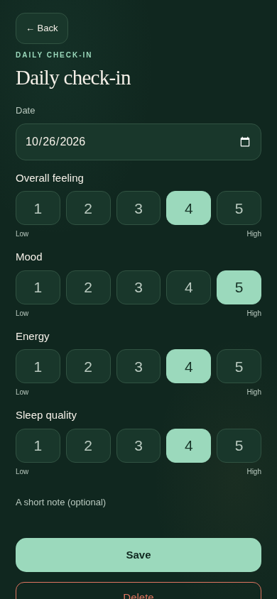
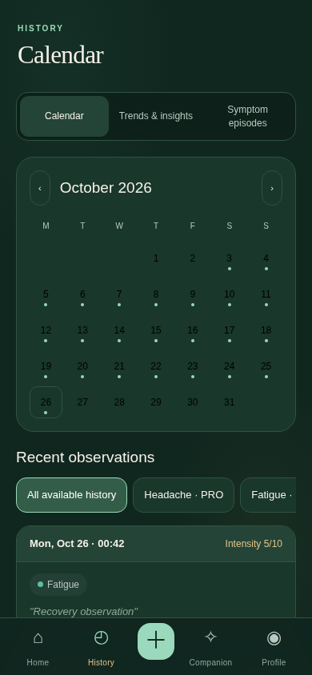
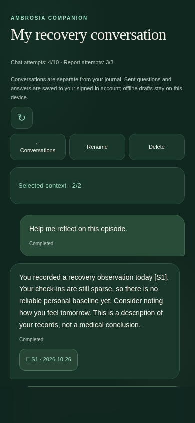

# Ambrosia 2.0 — product audit and decisions

Audit date: 26 October 2026. Baseline: main after PRs #17, #18 and the mobile sync-banner removal in #19. This is a repository/workflow audit and primary-source product comparison, not a user interview study, clinical evaluation or hands-on competitor benchmark.

## Research evidence

The following public pages were retrieved during this task. Statements below describe what each publisher says on those pages; ratings, efficacy, compliance claims and medical outcomes were not independently verified. No competitor pricing or trial offer has been copied into Ambrosia.

| Product / primary source | Publisher-described approach actually observed | Decision for Ambrosia |
| --- | --- | --- |
| [Bearable official site](https://bearable.app/) | Mood/symptom tracking, energy and sleep, custom metrics, weekly/monthly reports, correlations, health experiments and doctor-appointment communication. Its FAQ describes quick entry and reducing effort for people with fatigue/brain fog. | Put a short optional check-in first; keep data entry fast. Use descriptive statistics and explicit sufficiency, without repeating causal or efficacy claims. |
| [Guava official site](https://guavahealth.com/) | Organizing records from health portals, symptom/lifestyle tracking, health insights, searchable history and printable visit preparation. | Make history and clinician preparation reachable from recorded observations. Do not suggest Ambrosia imports labs, portals or wearable measurements: it does not. |
| [Daylio publisher listing on Google Play](https://play.google.com/store/apps/details?id=net.daylio&hl=en) | One-tap mood/activity selection, optional notes, charts, weekly/monthly/yearly mood statistics, a “Year in Pixels” view, reminders, goals and export. | Treat healthy days as useful observations, use a compact calendar and keep optional text optional. Do not add punitive streak mechanics. The Daylio website/FAQ returned HTTP 466; the publisher listing was used instead, not invented website research. |
| [CareClinic official site](https://careclinic.io/) | Broad symptoms/medication/lifestyle tracking, reminders, charts, visit summaries, records and care/caregiver features. | Support an explicit recovery episode and useful visit questions, while avoiding a large care-management form or pretending to implement medication adherence, validated assessments or treatment recommendations. |
| [Apple Health official overview](https://www.apple.com/ios/health/) | Publisher-described heart, sleep, activity and longitudinal device metrics, privacy controls and clinician-facing exports. | Keep self-reported feelings separate from measured physiology. Ambrosia does not claim Apple Health/device integration, clinical validation or hardware-derived readiness scores. |

Pricing research: Bearable’s retrieved FAQ described an optional paid subscription and promotions; Guava linked a Plans & Pricing page; Daylio’s listing presented in-app purchases. Comparable regional/cadence/tax-inclusive prices were not verified across all five products, so no numerical price ranking is asserted. Apple’s overview describes a hardware ecosystem rather than a directly comparable journal subscription.

Research limits: public marketing descriptions change and do not establish usability, safety, feature availability in every region, or comparative quality. Further research should include observed tasks with healthy users, people with fluctuating symptoms, and people using screen readers or experiencing fatigue. Those studies have not been performed here.

## Baseline weaknesses and the resulting implementation

| Existing journey/screen | Problem in the audited repository | Implemented change |
| --- | --- | --- |
| Onboarding | Symptom-only framing; old copy said nothing was sent to servers despite optional Supabase/Groq; three slides lacked full localization. | A localized healthy-day/symptom/privacy introduction. Account cloud storage and per-request Groq context are explained accurately. Language can be chosen before starting. |
| Home | Guessed “overall feeling” from symptoms; no reason to return on a healthy day; streak reward/broken-streak modal interrupted entry; little sufficiency information. | Actual daily check-in status, four self-reported dimensions, optional quick symptoms, observed-day trend, personal baseline only when supported, and recent observations. No streak modal or inferred health score. |
| Symptom log | Four compulsory-looking steps even for a short observation; no explicit onset/end or episode grouping. | Quick entry plus the existing advanced flow. Start/end and episode association are optional details. Existing symptoms, triggers, notes, intensity and follow-up status remain. |
| Entry detail | Status follow-up existed but was disconnected from longitudinal reflection. | Existing status actions remain, with a source-specific Companion action. No automatic diagnosis or episode inference. |
| History | A symptom-only reverse list and Premium filter; no daily view, wellness dimensions, recovery grouping or baseline. | Calendar with recorded-day indicators, daily check-in editing, full timeline, explicitly grouped episodes, local weekly statistics and charts. Advanced 90-day comparison remains Premium. |
| AI | Separate one-shot requests, no saved dialogue, no record-context inspector; repeatedly sending a whole period could exceed a prompt cap. | A dedicated full-width Companion destination with saved conversations, explicit field/period/source selection, bounded relevant records, local statistics, source links, failed-message recovery and separate chat quota. All five one-shot tools remain in an expandable section. |
| Profile/privacy | Symptom-only counts and earlier UI assumptions; export could not include the new record types/chat. | Counts include wellness days; existing account recovery, entitlement refresh, export and deletion remain. New kinds are inside the original sync archive; cloud/chat exports and deletion cascades are extended. |
| Navigation/layout | Div-based navigation, disabled pinch zoom, dense fixed styles and modal interruption. | Actual navigation buttons, visible focus, zoom enabled, safe-area/dynamic-height support, narrow-screen checks, a separate product stylesheet and no persistent sidebar/status banner. |

## Three daily journeys

**Healthy day:** Home → four optional 1–5 selections → optional note → Save. The daily identity prevents duplicate observations on another device. There is no requirement to invent a symptom, satisfy a streak or start an account. The 15-second goal is a design target (four selections plus Save), not a measured user-study result.

**Symptomatic day:** Home → Quick symptom entry → category/symptom/intensity → Save. Expand details only for onset, end, triggers/notes or an explicitly selected episode. Advanced entry retains the old step-by-step workflow. A journal observation can start a source-linked conversation, but it is not sent to Groq without another confirmation.

**Recovery:** Create a named episode, associate chosen observations, add status follow-ups and explicitly mark an episode recovering/recovered with an end date. Calendar and weekly statistics describe what was recorded. A later follow-up may discuss this selected episode; the assistant has no ability to edit its records.

## Differentiation and commercial value

The differentiator is not a broad claim to “find causes.” It is a journal that includes ordinary good days and gives the user a transparent, portable context layer: see selected records, field choices, omissions, coverage and source links before a contextual conversation. Statistics are deterministic and available without an AI request. A user can also export that same context to Markdown, JSON or CSV for another tool, with a privacy warning.

Free includes check-ins, symptom/episode recording, all history, essential weekly statistics/baselines, context export, account data export/deletion, and a limited server-controlled chat/report allowance. Premium adds 90-day comparisons, advanced filtering, more longitudinal preparation and larger configured AI allowances. There is no fake checkout, promised subscription price, automatic trial or unverified Google Play restore. Client UI is never the quota authority.

## Data and accessibility decisions

- Check-in IDs derive from a local calendar day in a shared client/SQL algorithm; the existing `(owner,id)` key provides account isolation. Guest check-ins migrate only after the existing explicit account merge consent.
- Check-ins and episodes use the existing atomic local outbox, CAS revisions, conflict archive and tombstones. Original numeric journal IDs/legacy keys are preserved. Extra entry fields are additive; old observations need no invented onset/end date.
- A baseline uses at least 14 earlier recorded days in the preceding 28 days; the weekly window excludes those baseline days. Missing days are absent, never “healthy” or zero-filled. A descriptive difference is not a diagnosis, improvement guarantee or causal finding.
- Chat lives in separate owner-scoped tables and an account-scoped local draft cache. Its message append/receipt rules do not reuse health-record mutation APIs. Conversation metadata may use last-confirmed-write behavior; messages and clinical observations are not silently overwritten by metadata changes.
- New/modified product controls have English, Ukrainian and Russian copy, semantic fields and keyboard buttons. Navigation/screen tests cover 320, 375, 390 and 430 px with no horizontal overflow. Focus, reduced motion, zoom, readable text and touch targets are addressed. Calendar cells use a compact seven-column layout; not every cell can be 44 px wide at 320 px. There is no claim of a completed independent WCAG audit.
- Android-style viewport resizing keeps the composer in a single scrollable column. There is no persistent side panel. Settings alone contains detailed sync state; the removed global banner is not restored.

## Screenshots

These are screenshots of the running implementation at 390 × 844 using synthetic test observations and a simulated provider answer. They are not mockups or evidence of live Groq/Supabase validation. The browser suite also checks the other required widths. Refresh deliberately with `UPDATE_SCREENSHOTS=1 npm run test:browser`; ordinary CI puts generated screenshots in its artifact directory rather than modifying tracked images.

| Home | Daily check-in |
| --- | --- |
|  |  |

| Calendar | Companion |
| --- | --- |
|  |  |

## Remaining product limitations

No wearable/medical portal import, medication planner, native billing, clinician messaging or medical-device/clinical validation is implied. Basic trends are self-reported observations. Very large local archives remain subject to browser storage limits. First-ever offline use cannot install the shell. The Companion needs a verified account and connectivity to send; offline questions stay drafts and are never automatically sent. See [the release and architecture guide](ambrosia-2-release.md) for context bounds, deletion/retry semantics and exact SQL Editor steps.

## Priority scores and feedback gate

Scores are audit judgments (severity 1–5 × frequency 1–5), not measured user-study outcomes: healthy-day gap **25/P0**; misleading privacy/onboarding **20/P0**; missing durable/context-controlled chat **20/P0**; mandatory-looking symptom steps **16/P1**; inadequate day/episode history **16/P1**; zoom/keyboard/mobile target issues **15/P1**; advanced longitudinal differentiation **9/P2**. The implemented release addresses P0/P1 and a bounded P2 comparison rather than adding unimplemented reminders, medication workflows or sensor imports.

For real usability feedback, ask representative volunteers to complete the healthy-day, symptom, recovery, context-review and account-switch journeys on their own device, using synthetic notes. Record task completion, errors, whether privacy/coverage is understood, perceived effort, and time to first useful non-AI insight. The 15-second goal and D1/D7/D30 retention are **unmeasured hypotheses**, not claims. If instrumentation is later introduced, make it explicit/optional and record aggregate events only (never notes, symptoms, message content or record IDs). Suggested aggregate measures: healthy-day participation, weekly active use, completion without assistance, and voluntary return after sparse weeks. Do not optimize guilt, fear or forced streaks. Obtain and act on actual participant feedback before the separate Android-packaging gate in issue #16; no such feedback or Android release is fabricated by this PR.
